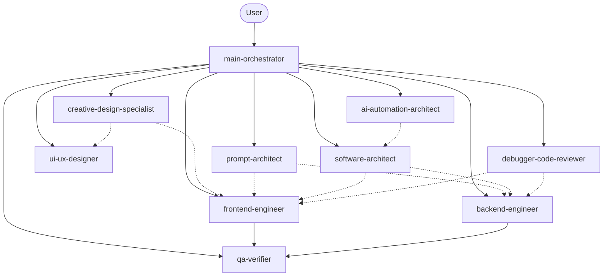

# Agent map

Ten agents total: **1 orchestrator + 9 specialists**.

## Roles

| Agent | Primary output | Typical readonly |
|-------|----------------|------------------|
| `main-orchestrator` | Plan, delegation, final report | no |
| `creative-design-specialist` | Design blueprint | no* |
| `prompt-architect` | Prompts | yes |
| `ui-ux-designer` | UX audit | yes |
| `frontend-engineer` | UI code | no |
| `software-architect` | Architecture plan | yes |
| `ai-automation-architect` | Workflow spec | yes |
| `backend-engineer` | Server code | no |
| `debugger-code-reviewer` | RCA, review, fixes | no |
| `qa-verifier` | Verification report | yes |

\*Creative specialist may implement when explicitly asked.

## Delegation paths (quick reference)

| Task type | Typical chain |
|-----------|----------------|
| New premium site | CDS → UX → FE → QA |
| Redesign | CDS + UX → FE → DR? → QA |
| Feature / product | PA? → SA → FE/BE → DR → QA |
| Automation | AA → SA → BE/FE → DR → QA |
| Prompts only | PA |
| Bug | DR → FE/BE → QA |
| Design direction only | CDS and/or UX |

## Distinctions

- **Creative** = original visual concept and blueprint.  
- **UI/UX** = usability, IA, a11y, conversion—without genericizing the concept.  
- **Frontend/Backend** = implementation.  
- **Debugger** = root cause and review.  
- **QA** = independent evidence-based verification.
